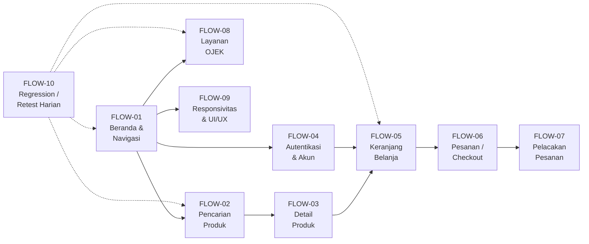

# Flow Pengetesan — IdBotani

**Status:** 28 Nov 2026. Sepuluh flow end-to-end di bawah ini disusun dari `test-cases.csv`
(IDB-BB-001 s.d. 018) dan hasil eksekusi manual 25–28 Nov 2026 di `05-Manual-Testing/`.
Metode: black-box (lihat `03-QA-Planning/metode-pengetesan.md`); acuan standar
ISO/IEC/IEEE 29119-1:2022, 29119-2:2021, dan ISO/IEC 25010:2023 di
`02-Standards-References/`.

## Gambaran umum

## Ringkasan 10 flow

| Flow | Alur | Test case | Status per 28 Nov 2026 |
| --- | --- | --- | --- |
| FLOW-01 | Beranda & navigasi | IDB-BB-001, IDB-BB-002 | PASS (25 Nov); **tertahan 28 Nov** — homepage 403 (IDB-BUG-007) |
| FLOW-02 | Pencarian produk | IDB-BB-003, IDB-BB-004 | PASS |
| FLOW-03 | Detail produk | IDB-BB-005 | PASS (temuan IDB-BUG-005) |
| FLOW-04 | Autentikasi & akun | IDB-BB-006 | PASS (temuan IDB-BUG-001, IDB-BUG-002; Google Login PENDING) |
| FLOW-05 | Keranjang belanja | IDB-BB-007 | PASS (temuan IDB-BUG-003, IDB-BUG-004) |
| FLOW-06 | Pesanan / checkout | IDB-BB-008 | **BLOCKED** — butuh sandbox & akun uji |
| FLOW-07 | Pelacakan pesanan | IDB-BB-009 | **BLOCKED** — butuh pesanan uji |
| FLOW-08 | Layanan OJEK | IDB-BB-011 s.d. IDB-BB-017 | PASS, kecuali IDB-BB-015 **FAIL** (IDB-BUG-006) |
| FLOW-09 | Responsivitas & UI/UX | IDB-BB-010, IDB-BB-018 | PASS |
| FLOW-10 | Regression / retest harian | Semua (selective) | Berjalan harian; 28 Nov: 0 Fixed, 6 bug tetap Open |

---

## FLOW-01 — Beranda & Navigasi (Smoke Test)

**Tujuan:** memastikan beranda dan navigasi kategori dapat dibuka dan elemen utama tampil.
**Precondition:** akses publik tersedia; browser Chrome/Firefox/Edge.
**Test case:** IDB-BB-001, IDB-BB-002.

| Langkah | Aksi | Expected result |
| --- | --- | --- |
| 1 | Buka `https://idbotani.com/` | Beranda tampil lengkap: logo, search, menu, slider, layanan Ojek, kategori, produk populer |
| 2 | Pilih kategori (mis. Makanan) | Halaman kategori dan hasil yang benar tampil (kategori Makanan: 3 produk — Wingko Rp 3.500, Sambal Pecel Rp 25.000, Dodol Rp 8.000) |

**Evidence:** `05-Manual-Testing/testing-evidence/IDB-BB-001/`, `IDB-BB-002/`.
**Status:** PASS (25 Nov 2026).
> **Catatan 28 Nov 2026:** flow ini **tertahan** — homepage mengembalikan `403 Forbidden`
> (IDB-BUG-007, Critical/P1). Jalankan ulang setelah layanan pulih.

## FLOW-02 — Pencarian Produk

**Tujuan:** memastikan pencarian mengembalikan hasil yang relevan, dan kata kunci yang
tidak cocok ditangani dengan informatif.
**Precondition:** beranda tersedia.
**Test case:** IDB-BB-003, IDB-BB-004.

| Langkah | Aksi | Expected result |
| --- | --- | --- |
| 1 | Cari kata kunci yang ada, mis. `Wingko`, lalu submit | Hasil yang relevan tampil (1 produk Wingko, Rp 3.500) |
| 2 | Cari kata kunci yang tidak ada, mis. `zxqvkjngasal123`, lalu submit | State tanpa hasil yang informatif tampil ("Terdapat 0 Produk", "Oops produk gak ditemukan") |

**Evidence:** `05-Manual-Testing/testing-evidence/IDB-BB-003/`, `IDB-BB-004/`.
**Status:** PASS.

## FLOW-03 — Detail Produk

**Tujuan:** memastikan halaman detail produk menampilkan informasi produk dengan lengkap
dan benar.
**Precondition:** produk terlihat di daftar/kategori.
**Test case:** IDB-BB-005.

| Langkah | Aksi | Expected result |
| --- | --- | --- |
| 1 | Buka produk dari daftar (mis. Wingko) | Detail tampil: nama, harga, minimal order 10 Pc, stok 10 Pc, jumlah dilihat, penjual terverifikasi, deskripsi |

**Evidence:** `05-Manual-Testing/testing-evidence/IDB-BB-005/`.
**Status:** PASS — dengan temuan **IDB-BUG-005**: harga detail tertulis `3.500` tanpa
awalan "Rp" (di daftar produk tertulis "Rp 3.500"); masih reproduksi pada retest
26, 27, dan 28 Nov 2026.

## FLOW-04 — Autentikasi & Akun

**Tujuan:** memastikan alur login, lupa password, dan login Google bekerja sesuai
ekspektasi.
**Precondition:** akses publik tersedia; akun uji bila diperlukan.
**Test case:** IDB-BB-006.

| Langkah | Aksi | Expected result |
| --- | --- | --- |
| 1 | Buka halaman login | Alur login tampil: field Email/No. Handphone OTP, tombol Masuk, Lupa Password, login Google, link Daftar |
| 2 | Minta kode OTP (Email/WA) | Kode OTP terkirim ke channel yang dipilih |
| 3 | Masukkan kode OTP dari channel resmi | Verifikasi berhasil, login selesai |
| 4 | Pilih Lupa Password, minta email reset | Email reset terkirim ke Gmail |
| 5 | Pilih login Google | Pemilih akun Google tampil; setelah memilih akun, login selesai |

**Evidence:** `05-Manual-Testing/testing-evidence/IDB-BB-006/`.
**Status:** PASS — dengan temuan:
- **IDB-BUG-001:** OTP tidak pernah terkirim ke WA/email (termasuk setelah resend).
- **IDB-BUG-002:** keenam kotak kode OTP terisi otomatis oleh halaman itu sendiri;
  klik "Proses Token" membuat verifikasi berhasil tanpa kode dari channel resmi.
- Lupa Password: permintaan reset terkirim, tetapi email reset yang diminta 27 Nov
  08.47 WIB **tidak ditemukan** di Gmail setelah ~24 jam — keterlambatan tersingkir,
  mendukung IDB-BUG-001.
- Google Login: **PENDING** — pemilih akun sudah tertutup; butuh klik pengguna
  untuk memilih akun secara sadar.

## FLOW-05 — Keranjang Belanja

**Tujuan:** memastikan penambahan dan penghapusan produk di keranjang tercatat dengan
benar, termasuk kuantitas dan total.
**Precondition:** akun uji yang disetujui dan izin pengujian.
**Test case:** IDB-BB-007.

| Langkah | Aksi | Expected result |
| --- | --- | --- |
| 1 | Buka detail Wingko, tambah ke keranjang dengan kuantitas 1 | Keranjang mencatat item dan kuantitas yang benar; bila ada minimal order, pemberitahuan tampil |
| 2 | Buka halaman keranjang | Item, kuantitas, subtotal, dan total tampil benar |
| 3 | Hapus item lewat tombol X **tanpa reload** halaman | Daftar, ringkasan, mini-keranjang, dan badge ikut kosong |
| 4 | Reload halaman | Keranjang terkonfirmasi kosong di semua tempat |

**Evidence:** `05-Manual-Testing/testing-evidence/IDB-BB-007/`.
**Status:** PASS — dengan temuan:
- **IDB-BUG-003:** kuantitas 1 otomatis naik ke minimal order 10 (total Rp 35.000)
  tanpa pemberitahuan.
- **IDB-BUG-004:** setelah hapus tanpa reload, ringkasan (Subtotal/Total Rp 35.000 +
  tombol "Lanjut ke Pembayaran"), mini-keranjang, dan badge masih menampilkan item;
  setelah reload keranjang benar-benar kosong.
- Keranjang ditinggalkan dalam keadaan **kosong** setelah pengujian.

## FLOW-06 — Pesanan / Checkout

**Tujuan:** memastikan pesanan uji tercatat tanpa pembayaran nyata.
**Precondition:** sandbox dan akun uji yang disetujui; data dummy.
**Test case:** IDB-BB-008.

| Langkah | Aksi | Expected result |
| --- | --- | --- |
| 1 | Lengkapi alur pemesanan yang disetujui di sandbox dengan data dummy | Pesanan uji tercatat tanpa pembayaran nyata |

**Status:** **BLOCKED** — tidak ada sandbox dan akun uji; pesanan tidak boleh dibuat
di situs live. Jangan jalankan flow ini di production.

## FLOW-07 — Pelacakan Pesanan

**Tujuan:** memastikan status pesanan milik sendiri tampil dengan benar.
**Precondition:** pesanan uji milik sendiri sudah ada.
**Test case:** IDB-BB-009.

| Langkah | Aksi | Expected result |
| --- | --- | --- |
| 1 | Buka pelacakan untuk pesanan uji milik sendiri | Status pesanan yang benar tampil |

**Status:** **BLOCKED** — tidak ada pesanan uji di situs live (bergantung pada FLOW-06).

## FLOW-08 — Layanan OJEK

**Tujuan:** memastikan pemesanan kurir lewat peta, ongkir, dan riwayat pesanan bekerja.
**Precondition:** akses publik tersedia.
**Test case:** IDB-BB-011 s.d. IDB-BB-017.

| Langkah | Aksi | Expected result |
| --- | --- | --- |
| 1 | Buka `https://idbotani.com/k/ojek` | Halaman "Pesan Layanan Kurir" tampil: Alamat Jemput/Tujuan, Daftar Produk, History Pemesanan, peta |
| 2 | Atur Alamat Jemput lewat modal "Pilih Lokasi Jemput" (peta Leaflet/OpenStreetMap), klik "Gunakan Titik Ini" | Titik jemput terisi dan tampil |
| 3 | Atur Alamat Tujuan lewat modal "Pilih Lokasi Tujuan" | Tujuan terisi; garis rute dan estimasi jarak/durasi tampil |
| 4 | Pilih kurir (Instant/Regular), klik "Hitung Ongkir" | Estimasi ongkir tampil |
| 5 | Isi Daftar Produk (nama barang dan qty) | Produk tampil di Daftar Produk |
| 6 | Klik "Pesan Sekarang" tanpa Alamat Jemput/Tujuan | Peringatan "Data Belum Lengkap" tampil; tidak ada pesanan dibuat |
| 7 | Buka History Pemesanan | State kosong tampil ("Belum ada history pemesanan.") bila belum ada pesanan |

**Evidence:** `05-Manual-Testing/testing-evidence/IDB-BB-011/` s.d. `IDB-BB-017/`.
**Status:** PASS, kecuali IDB-BB-015 **FAIL** — temuan **IDB-BUG-006**: bagian
"Daftar Produk" maupun field nama produk/qty tidak ada di halaman, baik sebagai
tamu maupun saat login.
> **Perbaikan precondition (temuan 28 Nov, perlu verifikasi browser):** elemen
> `#kurirProdukWrap` ("Daftar Produk") ada di DOM dan hanya tampil bila jenis
> layanan kurir **Delivery/Belanja** dipilih. Sebelum mengulang langkah 5, pilih
> dulu jenis layanan tersebut, screenshot hasilnya, lalu perbarui precondition
> IDB-BB-015 di `test-cases.csv`. Jangan langsung menutup BUG-006 tanpa bukti.
>
> **Catatan ongkir:** pada jarak 0,09 km ongkir tampil Rp 0 untuk Instant maupun
> Regular — perlu verifikasi apakah tarif benar atau kesalahan perhitungan.

## FLOW-09 — Responsivitas & UI/UX

**Tujuan:** memastikan tampilan tetap usable di layar mobile dan pengalih bahasa
bekerja.
**Precondition:** beranda tersedia.
**Test case:** IDB-BB-010, IDB-BB-018.

| Langkah | Aksi | Expected result |
| --- | --- | --- |
| 1 | Buka beranda pada viewport mobile 390x844 | Layout usable: search, grid produk 2 kolom, navigasi bawah Home/Menu/Mall/Video/Masuk; tidak ada elemen terpotong |
| 2 | Ganti bahasa antarmuka ID → EN → ZH → ID | Teks antarmuka berubah sesuai bahasa yang dipilih |

**Evidence:** `05-Manual-Testing/testing-evidence/IDB-BB-010/`, `IDB-BB-018/`.
**Status:** PASS.
**Catatan:** pengalih bahasa bekerja lewat widget Google Translate (bilah
"Diterjemahkan ke..." muncul), bukan terjemahan native — sebagian teks tetap
Indonesia. Bahasa dikembalikan ke Indonesia setelah pengujian.

## FLOW-10 — Regression / Retest Harian

**Tujuan:** memastikan perubahan di sisi situs live (dan waktu) tidak merusak fungsi
yang sudah ada — selective regression sesuai `06-Automation-Testing/regression-plan.md`.
**Precondition:** hasil eksekusi hari sebelumnya tersedia.
**Test case:** semua (selective — hanya yang relevan).

| Langkah | Aksi | Expected result |
| --- | --- | --- |
| 1 | Jalankan smoke: IDB-BB-001, 002, 003, 004, 010, 011, 016, 017, 018 (atau automation AT-01 s.d. AT-07) | Semua smoke PASS, atau defect baru tercatat |
| 2 | Retest 6 bug Open: IDB-BUG-001/002 (IDB-BB-006), 003/004 (IDB-BB-007), 005 (IDB-BB-005), 006 (IDB-BB-015, dengan precondition yang diperbaiki) | Status tiap bug diperbarui dengan bukti (PASS = Fixed, tetap FAIL = Open) |
| 3 | Catat hasil di `05-Manual-Testing/test-execution-log-YYYY-MM-DD.md` | Log harian lengkap dengan evidence |
| 4 | Perbarui ringkasan metrik, `Bug_Report_Idbotani.md`, dan `evidence-index.md` | Angka dan status konsisten di semua dokumen |

**Status:** berjalan harian 25–28 Nov 2026. Retest 28 Nov 2026 (08.43–08.48 WIB):
**0 Fixed, 6 bug tetap Open** (IDB-BUG-001 s.d. 006 masih reproduksi).
**Jangan jalankan** IDB-BB-008/009 — tetap BLOCKED.

## Batasan

- Semua flow bersifat non-destruktif: tidak ada pesanan nyata, pembayaran, atau
  perubahan data pengguna.
- FLOW-06 dan FLOW-07 tidak boleh dijalankan di situs live tanpa sandbox dan akun
  uji yang disetujui.
- Grey-box / white-box tidak tercakup di flow ini — keduanya BLOCKED sampai
  pengelola memberikan akses dan persetujuan (lihat `05-Manual-Testing/`).

## Referensi

- `04-Test-Cases/test-cases.csv`
- `03-QA-Planning/metode-pengetesan.md`
- `03-QA-Planning/test-plan.md`
- `06-Automation-Testing/regression-plan.md`
- `06-Automation-Testing/retest-checklist-2026-11-28.md`
- `05-Manual-Testing/test-execution-log-2026-11-25.md` s.d. `2026-11-28.md`
