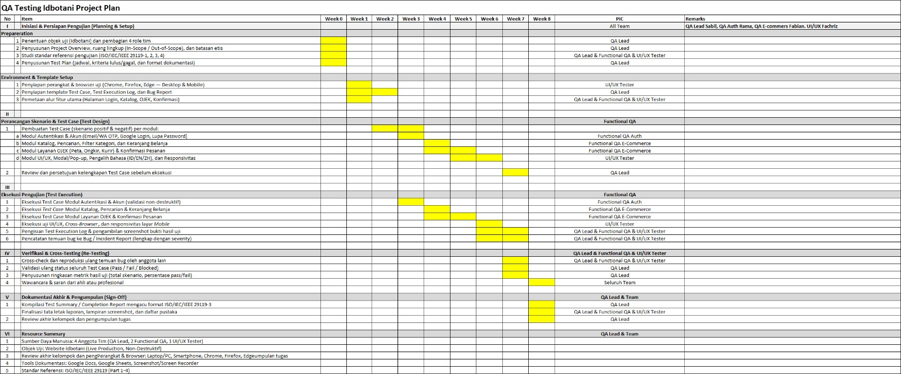

# Laporan Pengujian Perangkat Lunak (Quality Assurance Testing) — Website Idbotani

Repositori ini disusun sebagai dokumentasi resmi kegiatan pengujian perangkat lunak (_Software Testing & Quality Assurance_) terhadap aplikasi berbasis web **Idbotani** (`https://idbotani.com/`). Proyek ini dibuat untuk memenuhi tugas kelompok mata kuliah **Testing & QA Perangkat Lunak** di **Universitas Pamulang**.

## 🗓️ Timeline Pengujian (Week 0–8)



Jadwal pelaksanaan pengujian mengikuti _QA Testing Idbotani Project Plan_ (Week 0–8, sampai Sign-Off di Week 8). Dokumen sumber: [Timeline QA Testing Botani new.pdf](01-Project-Overview/Timeline%20QA%20Testing%20Botani%20new.pdf) dan [Timeline QA Testing Botani.xlsx](01-Project-Overview/Timeline%20QA%20Testing%20Botani.xlsx).

## 🧭 Jelajahi Repositori

Klik tautan di bawah untuk langsung membuka folder yang dicari, tanpa menelusuri repositori satu per satu:

- [01-Project-Overview](https://github.com/MOLAdev20/qa-kelompok-5/tree/master/01-Project-Overview) — profil, latar belakang, scope, timeline
- [02-Standards-References](https://github.com/MOLAdev20/qa-kelompok-5/tree/master/02-Standards-References) — ISO 25010, ISO/IEC/IEEE 29119, literature review
- [03-QA-Planning](https://github.com/MOLAdev20/qa-kelompok-5/tree/master/03-QA-Planning) — test plan, strategi, jadwal, task distribution
- [04-Test-Cases](https://github.com/MOLAdev20/qa-kelompok-5/tree/master/04-Test-Cases) — test-cases.csv (IDB-BB-001 s.d. 018)
- [05-Manual-Testing](https://github.com/MOLAdev20/qa-kelompok-5/tree/master/05-Manual-Testing) — log eksekusi, evidence, metrik
- [06-Automation-Testing](https://github.com/MOLAdev20/qa-kelompok-5/tree/master/06-Automation-Testing) — skrip Playwright read-only, regression plan
- [07-Bug-Reports](https://github.com/MOLAdev20/qa-kelompok-5/tree/master/07-Bug-Reports) — laporan bug & evidence
- [08-Interview](https://github.com/MOLAdev20/qa-kelompok-5/tree/master/08-Interview) — pertanyaan wawancara
- [09-Final-Report](https://github.com/MOLAdev20/qa-kelompok-5/tree/master/09-Final-Report) — draf laporan akhir

## 📝 Catatan Dosen

Sesuai arahan dosen pengampu:

- Acuan plan testing berdasarkan standar ISO yang dipilih kelompok: **ISO/IEC/IEEE 29119** (Part 1–4) untuk proses dan dokumentasi pengujian, dan **ISO/IEC 25010** untuk model kualitas produk. Lihat [02-Standards-References](https://github.com/MOLAdev20/qa-kelompok-5/tree/master/02-Standards-References).
- Timeline pengujian ditaruh di halaman depan README ini (bagian 🗓️ Timeline Pengujian di atas).
- README dibuat interaktif: tidak perlu masuk-masuk folder — setiap bagian dilengkapi tautan langsung ke folder/file terkait (lihat 🧭 Jelajahi Repositori di atas), jadi pemeriksa bisa langsung membuka folder yang dicari.

## 📋 Identitas Penyusun

### Anggota Kelompok

| No  | Nama Mahasiswa              | NIM            |
| :-: | --------------------------- | -------------- |
|  1  | `Fabian Jason Song`         | `231011400173` |
|  2  | `M Fachris Aziz Wantah`     | `231011402121` |
|  3  | `M Sabiilul Hikam Azzuhrie` | `231011400198` |
|  4  | `Rama Niitia Khadifa`        | `231011403642` |

### Informasi Akademik

| Keterangan           | Informasi                          |
| -------------------- | ---------------------------------- |
| **Kelompok**         | Kelompok 5                         |
| **Kelas / Ruang**    | V.714                              |
| **Program Studi**    | Teknik Informatika                 |
| **Fakultas**         | Ilmu Komputer                      |
| **Perguruan Tinggi** | Universitas Pamulang               |
| **Mata Kuliah**      | Testing & QA Perangkat Lunak       |
| **Dosen Pengampu**   | `ASEP ERLAN MAULANA S.KOM., M.KOM` |

## 🌐 Profil Objek Pengujian

- **Nama Aplikasi:** Idbotani
- **URL Target:** <https://idbotani.com/>
- **Kategori:** _E-Commerce_ / _Marketplace_ Berbasis Web

### Tentang Idbotani

**Idbotani** adalah platform _marketplace_ berbasis web yang berfokus pada kemudahan transaksi jual beli produk **petani dan UMKM (Usaha Mikro, Kecil, dan Menengah)** di Indonesia. Platform ini mempertemukan pelaku usaha (pelapak) dengan konsumen secara daring, sekaligus menyediakan beragam fitur pendukung transaksi dan logistik.

### Fitur Utama yang Tersedia pada Sistem

Berdasarkan observasi awal terhadap sistem, fitur-fitur utama yang terdapat pada situs web Idbotani meliputi:

1. **Autentikasi & Manajemen Akun:** Registrasi pengguna baru, masuk (_login_) menggunakan _email_ atau nomor WhatsApp (dengan verifikasi kode OTP), _login_ melalui akun Google, serta pemulihan kata sandi (_Lupa Password_).
2. **Katalog & Pencarian Produk:** Pencarian produk berdasarkan kata kunci, tren pencarian (_trending_), serta klasifikasi kategori (seperti Makanan, Minuman, Keripik, Olahan Pangan, Sambal, Ikan Hias, Peralatan Berkebun, Peralatan Rumah Tangga, hingga Produk Digital).
3. **Keranjang Belanja & Pemesanan:** Penambahan dan penghapusan produk di keranjang belanja, _Group Orders_, konfirmasi pesanan (_Konfirmasi Orders_), pelacakan status pengiriman (_Tracking Orders_), serta laporan pesanan (_Orders Report_).
4. **Layanan Ojek & Pengiriman (_Delivery_):** Fitur pemesanan kurir (_Instant_ dan _Regular_) dengan penentuan titik jemput dan alamat tujuan melalui peta interaktif, perhitungan estimasi ongkos kirim, serta layanan titip belanja.
5. **Ekosistem Pelapak & Komunitas:** Direktori _Idbotani Mall_, daftar toko pelapak, program afiliasi (_Affiliate Program_), serta fitur konten seperti _Blog_ dan _Forum_.
6. **Fungsionalitas Pendukung:** Pengaturan multi-bahasa (Bahasa Indonesia, Bahasa Inggris, dan Bahasa Mandarin), pusat notifikasi, kotak masuk (_Inbox_), serta layanan bantuan pelanggan.

## 🎯 Tujuan dan Ruang Lingkup Pengujian

### Tujuan Pengujian

1. Memastikan seluruh fungsionalitas utama pada situs web Idbotani berjalan sesuai dengan ekspektasi dan kebutuhan pengguna.
2. Mengidentifikasi cacat perangkat lunak (_bugs_), ketidaksesuaian antarmuka (_UI/UX issues_), maupun kendala teknis lainnya yang dapat memengaruhi pengalaman pengguna.
3. Memberikan laporan hasil pengujian yang terstruktur beserta rekomendasi perbaikan guna meningkatkan kualitas perangkat lunak.

### Ruang Lingkup Pengujian (_Test Scope_)

Pengujian difokuskan pada modul-modul utama yang dapat diakses oleh pengguna umum (_guest_) maupun pengguna terdaftar (_registered user_), antara lain:

- Modul Autentikasi (_Login_, Registrasi, dan Lupa Kata Sandi).
- Modul Navigasi, Kategori, dan Pencarian Produk.
- Modul Keranjang Belanja (_Add to Cart_, _Update Quantity_, dan _Remove Item_).
- Modul Layanan Ojek/Pengiriman (interaksi peta dan formulir pemesanan).
- Modul Konfirmasi & Pelacakan Pesanan.
- Pengujian Antarmuka (_UI/UX_) dan Responsivitas pada berbagai ukuran layar (_Desktop_ & _Mobile_).

## 🧪 Metode dan Alat Bantu Pengujian

### Metode Pengujian

- **_Black-Box Testing_:** Pengujian fungsionalitas sistem berdasarkan _input_ dan _output_ yang diharapkan tanpa melihat struktur kode internal (menggunakan teknik seperti _Equivalence Partitioning_ dan _Boundary Value Analysis_).
- **_Usability & UI Testing_:** Evaluasi kemudahan penggunaan, konsistensi tata letak, keterbacaan teks, serta kejelasan umpan balik sistem.
- **_Compatibility Testing_:** Pengujian kesesuaian tampilan dan fungsi pada berbagai peramban (_browser_) serta resolusi perangkat.

### Lingkungan & Alat Bantu (_Tools_)

_(Sesuaikan daftar di bawah ini dengan alat bantu yang digunakan oleh kelompok Anda)_

- **Peramban (_Browser_):** Google Chrome, Mozilla Firefox, Microsoft Edge.
- **Dokumentasi _Test Case_ & _Bug Report_:** Microsoft Excel / Google Sheets / Markdown.
- **Alat Inspeksi & Performa:** Chrome DevTools, Google Lighthouse.
- **Alat Otomasi:** Playwright (Node.js) untuk UI read-only — skrip di `06-Automation-Testing/scripts/`, acuan Pertemuan 10 (Selenium/Cypress dibahas sebagai pembanding di `06-Automation-Testing/README.md`). API (Postman/Newman) belum digunakan karena tidak ada akses/dokumentasi API resmi.

## 📁 Struktur Repositori

Berikut adalah struktur direktori yang digunakan untuk mengorganisasi dokumen pengujian di dalam repositori ini:

```text
├── README.md
├── 01-Project-Overview/         # Profil, latar belakang, scope, timeline
├── 02-Standards-References/     # ISO 25010, ISO 29119, literature review
├── 03-QA-Planning/              # Test plan, strategi, jadwal, task distribution
├── 04-Test-Cases/               # test-cases.csv (IDB-BB-001 s.d. 018)
├── 05-Manual-Testing/           # Log eksekusi 25–27 Nov, evidence, metrik
├── 06-Automation-Testing/       # Skrip Playwright read-only, regression plan
├── 07-Bug-Reports/              # Bug_Report_Idbotani.md (IDB-BUG-001 s.d. 006)
├── 08-Interview/                # Pertanyaan wawancara (belum dilakukan)
└── 09-Final-Report/             # Draf laporan akhir (laporan-akhir-qa-idbotani.md)
```

## 📊 Ringkasan Hasil Pengujian

Per 27 Nov 2026, dari `04-Test-Cases/test-cases.csv` (18 test case IDB-BB-001 s.d. 018).
Detail per area ada di `09-Final-Report/laporan-akhir-qa-idbotani.md`.
Automation Playwright (AT-01 s.d. AT-08) sudah dibuat 28 Nov 2026 tetapi belum dieksekusi,
jadi belum masuk hitungan di bawah ini.

| Modul yang Diuji               | Total _Test Case_ | _Passed_ | _Failed_ | _Blocked_ | Persentase Keberhasilan |
| ------------------------------ | :---------------: | :------: | :------: | :-------: | :---------------------: |
| Autentikasi (Login/Register)   |        `1`        |   `1`    |   `0`    |    `0`    |         `100%`          |
| Pencarian & Filter Produk      |        `2`        |   `2`    |   `0`    |    `0`    |         `100%`          |
| Keranjang Belanja              |        `1`        |   `1`    |   `0`    |    `0`    |         `100%`          |
| Layanan Ojek / Pengiriman      |        `7`        |   `6`    |   `1`    |    `0`    |          `86%`          |
| Konfirmasi & Pelacakan Pesanan |        `2`        |   `0`    |   `0`    |    `2`    |          `0%`           |
| Antarmuka & Responsivitas      |        `5`        |   `5`    |   `0`    |    `0`    |         `100%`          |
| **Total Keseluruhan**          |      **`18`**     | **`15`** | **`1`**  |  **`2`**  |        **`83%`**        |

Catatan: 6 bug masih Open (IDB-BUG-001 s.d. 006, 2 High/P1 soal OTP).
Lihat `07-Bug-Reports/Bug_Report_Idbotani.md`.

## ⚠️ Pernyataan Akademik (_Disclaimer_)

Seluruh aktivitas pengujian yang terdokumentasi dalam repositori ini dilakukan secara etis dan semata-mata untuk **keperluan pembelajaran akademik** pada mata kuliah Testing & QA Perangkat Lunak di Universitas Pamulang. Pengujian tidak melibatkan tindakan eksploitatif atau pengujian keamanan invasif yang dapat mengganggu ketersediaan layanan maupun data pada situs web <https://idbotani.com/>.
